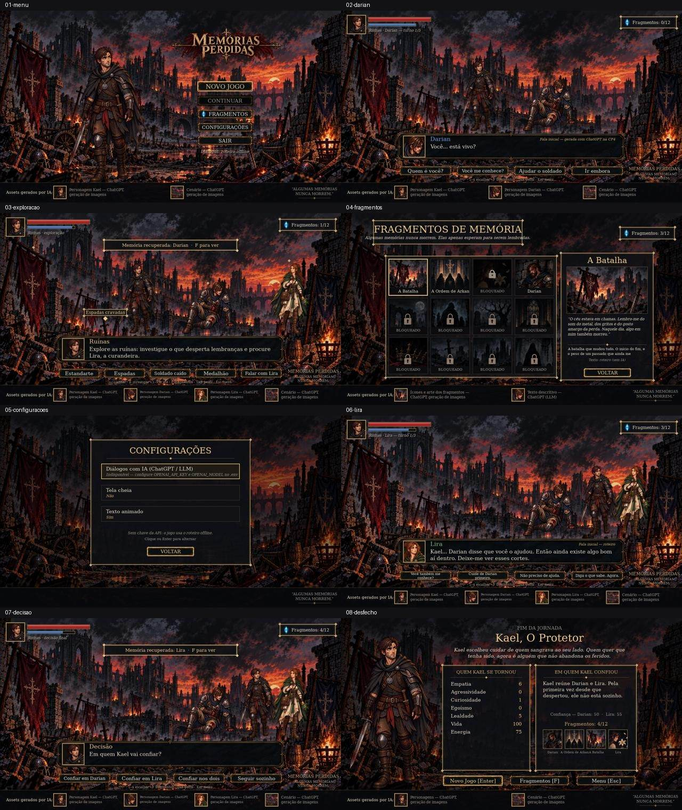

# Revisão de entrega — Memórias Perdidas / CP5 de PLN

Data: 09/10/2026. Integrantes da CP4 confirmados: Rafael de Paiva Ramos — RM 563978 e Thiago Santana Danyluk — RM 562286.

**Conclusão:** versão Paiva validada tecnicamente em modo offline e com cliente de IA simulado nos testes. A jornada chega ao desfecho. Os assets gerados por IA da CP4 estão integrados ao jogo. A entrega acadêmica ainda exige vídeo, explicação própria dos integrantes e checklist manual. Nenhuma chamada real à API foi feita nesta revisão.

## 1. Fontes conferidas

- [Enunciado oficial da CP5 de PLN](https://fiapcom.sharepoint.com/sites/msteams_1482e2/Class%20Files/Assignments/CP5%20-%20MVP%20do%20Jogo/CP5_game_mvp.pdf?web=1), publicado em 26/09/2026, obtido no SharePoint da turma pelo anúncio do Teams.
- CP4 entregue no Teams: `CP4_Memorias_Perdidas_Relatorio_Completo_Atualizado 1.pdf`, pasta Submitted files / Thiago Santana Danyluk / CP4 - PLN - Jogo usando IA generativa / Versão 2. Foram conferidos texto, integrantes, mecânicas, personagens e descrição dos três mockups; não houve nova comparação visual página a página do PDF nesta revisão.
- Mensagens do canal Processamento de Linguagem Natural Chatbots e Vi: o professor Sergio Palmiere indica o material da disciplina no Google Drive. Nenhuma alteração de requisitos da CP5 foi encontrada nas mensagens recuperadas.
- Repositório `Danylukk/memorias-perdidas`: todas as branches, histórico, código, dados, assets, documentação e testes disponíveis.
- Os anexos `Dicas de Pitch.pdf` e `IMG_7847.webp` tratam do projeto SOMPO (pitch e risco de cargas), e não do jogo de PLN; não foram utilizados como requisitos do MVP.

O texto completo dos cartões de Assignments e o horário-limite da tarefa não são expostos pelo conector usado. O PDF oficial foi lido, mas não foi possível confirmar por esse caminho o horário de encerramento nem ler o documento separado Regras do Jogo. Conferir ambos na tarefa antes do envio.

## 2. O que o professor exige

| Requisito | Evidência / situação |
| --- | --- |
| Mesmo jogo, título, gênero e premissa da CP4 | Memórias Perdidas, RPG narrativo dark fantasy, Kael sem memória; mantidos |
| Menu e gameplay correspondentes ao mockup | Telas funcionais em 16:9, com HUD e personagens oficiais; inspecionadas |
| No mínimo 3 mecânicas da CP4 | Exploração, escolhas e fragmentos jogáveis; diálogos de texto com adaptador de API e fallback |
| Começo, meio e fim | Darian → exploração → Lira → decisão → desfecho; percursos completos testados |
| Uma modalidade de IA generativa integrada | Imagens pré-geradas aprovadas na CP4 aparecem no jogo. O próprio enunciado aceita asset pré-gerado integrado. A chamada atual de texto não foi verificada com credencial real |
| Código completo e README | Presentes; instruções de instalação corrigidas para um checkout novo |
| Vídeo de 2 a 5 minutos | **Pendente:** nenhum arquivo ou link de vídeo encontrado no repositório |
| Diário com pelo menos 5 prompts reais e ajustes | Nove prompts anteriores documentados; esta revisão acrescenta o prompt real 10. O grupo deve conferir o histórico e completar os campos de revisão |
| Explicação do código escrita pelo grupo, sem IA | **Pendente**, conforme exigência explícita da Etapa 3. Os tópicos existentes são orientação, não a explicação autoral |
| Diário de mudanças, com justificativas reais | Presente em ENTREGA_CP5.md, incluindo redução de escopo e mudança para API. O grupo deve confirmar as justificativas históricas |
| Checklist manual com resultado obtido | **Pendente:** as linhas originais ainda aguardam execução e preenchimento pelos integrantes |
| Mesmo grupo da CP4 | Os dois integrantes são os mesmos da CP4 entregue |

O enunciado recomenda consolidar os textos em PDF ou Word; não torna essa consolidação obrigatória. Código e documentos podem ser entregues em ZIP ou link do repositório. Vídeo e acesso do professor devem acompanhar a entrega. Um repositório privado exige acesso concedido ou envio do ZIP.

## 3. Branches e decisão de integração

| Branch | SHA revisado | Resultado |
| --- | --- | --- |
| main, antes da integração | cc633040314a83634141b2eb8b877b0402d77d3e | Primeira versão: somente encontro inicial |
| paiva | b2a2d9bb79183e2ff08ca345c75b06190a5d3499 | Cinco commits à frente da main, zero atrás; base escolhida |
| paiva_v2 | b2a2d9bb79183e2ff08ca345c75b06190a5d3499 | Idêntica à Paiva; não há atualização adicional para mesclar |
| feat/vertical-slice | 82c2c620491dccaf2e14235701bb38428770d7de | Uma linha divergente; 53 testes passam, mas o fluxo real de desenho falha |

Os últimos commits da Paiva, por `paivazzz`, datam de 28 e 29/09/2026. O último acrescenta a reação de Lira a Darian, soldado caído, medalhão e fade. Não foram encontradas alterações posteriores nas quatro branches disponíveis na consulta.

Falha reproduzida na vertical slice: iniciar Novo Jogo, completar a transição com `app.update()` e desenhar `ExploreScreen` gera `NameError: name 'panel' is not defined` em `game/screens/explore.py`. Seus testes não desenham essa tela. A cópia de revisão usou os arquivos de código e dados dessa branch e os assets compartilhados da Paiva; a falha ocorre no símbolo Python não importado.

**Decisão:** integrar a jornada da Paiva e as correções desta revisão por branch/PR próprio, preservando as branches originais. As ideias compatíveis da vertical slice já estavam incorporadas no último commit da Paiva. Não executar merge integral da vertical slice.

## 4. Correções realizadas

| Problema comprovado | Correção e impacto |
| --- | --- |
| Novo Jogo → Esc antes da primeira escolha não disponibilizava Continuar | Salvar o estado inicial ao iniciar a partida; salvar ao voltar ao menu ou fechar, quando não há geração pendente |
| Medalhão alterava curiosidade sem salvar imediatamente pelo botão | Persistir após a interação; retomada mantém o efeito e não o aplica novamente |
| Contador ultrapassava a moldura | Ajustar o tamanho da fonte ao espaço útil |
| Créditos com Kael, Darian, Lira e cenário cortavam na borda direita | Distribuir itens em colunas e adaptar a fonte; preservados todos os créditos |
| Falas longas válidas podiam perder linhas | Caixa mantém sua base e cresce para cima quando necessário, sem cobrir as escolhas; palavras longas também são quebradas |
| Lembranças longas podiam ficar incompletas na galeria | Paginação do texto com PgUp/PgDn ou roda do mouse, com indicação da página |
| Quatro opções distintas podiam repetir a mesma intenção | Rejeitar intenções repetidas e usar o tratamento de falha/roteiro existente |
| Prompt proibia novas escolhas enquanto o esquema as solicitava | Autorizar sugestões somente quando o formato do turno pedir; progressão segue no Python |
| Fala offline de Lira afirmava que Kael era soldado | Substituir a afirmação por referência ao comportamento presente nas ruínas; respeitar a restrição de revelação |
| README afirmava que o .venv já vinha instalado | Orientar instalação real após obter o repositório; limitar compileall ao código do projeto |

Sem alterações no título, personagens, assets oficiais, stack, regras de atributos, thresholds, quantidade de turnos ou modalidades de IA. O save preserva o estado narrativo; a posição exata do personagem na exploração não é persistida. Durante geração pendente, as escolhas continuam bloqueadas e o fechamento preserva o último save concluído.

## 5. Evidências de execução

Ambiente: Linux, Python 3.12.14, Pygame 2.6.1, OpenAI SDK 2.54.0. Dependências instaladas a partir de requirements.txt. Screenshots geradas pelo desenho real das telas Pygame com SDL dummy e inputs controlados; não são mockups.

| Verificação | Resultado obtido |
| --- | --- |
| Suíte original da Paiva | 81 testes aprovados |
| Treze testes de regressão desta revisão | 13 aprovados |
| Suíte final: `python -m pytest -q` | **94 aprovados**, 0 falhas (4,74 s na execução final de código) |
| `python -m compileall -q game tests main.py` | Código de saída 0 |
| `git diff --check` | Sem erros |
| Oito telas desenhadas e inspecionadas | Menu, Darian, exploração, fragmentos, configurações, Lira, decisão e desfecho |
| Jornada offline executada para a inspeção | Desfecho O Protetor, confiança Darian 50 / Lira 55, 4/12 fragmentos; vida 100, energia 75, empatia 6, curiosidade 1, lealdade 5 |
| Caminhos offline e regras | Cobertos pela suíte, incluindo caminhos distintos, exploração e consequências de Darian sobre Lira |
| Falha de IA e tentativa explícita | Testes com cliente controlado; efeitos não reaplicados |
| Mudança de escala e clique de janela | Cobertos pelos testes de interface existentes |
| Chamada real à API nesta revisão | **Não executada:** não havia configuração local de credencial/modelo neste ambiente |
| Validação manual no Windows do grupo | **Não executada por esta revisão** |

**Distinção de evidências:** execução automatizada de eventos e inspeção de screenshots não equivalem aos testes manuais realizados pelos integrantes. Esta tabela não deve ser copiada como se o grupo tivesse executado manualmente cada cenário. O histórico de HTTP 200 em RELATORIO_MVP.md refere-se à primeira versão; não comprova as opções geradas atuais nem a conversa de Lira com a API real.

## 6. Usabilidade e coerência

- Fluxo compreensível: apresentação de Darian, investigação das ruínas, reação de Lira ao tratamento do soldado, escolha de confiança e consequência final.
- Mouse e teclado funcionais nas telas e ações cobertas; configuração permite desligar texto animado. Há feedback de espera, mudanças de atributos, fragmentos e falha com fallback.
- IA e roteiro offline são identificados separadamente na caixa de diálogo. A origem do texto de cada memória aparece no detalhe.
- Os quatro fragmentos da CP4 são recuperáveis. Os oito restantes são explicitamente futuros; o contador 4/12 não representa uma fase incompleta desta jornada.
- Não há combate, múltiplos mapas ou história completa: a entrega é um capítulo narrativo. Essas reduções estão documentadas.
- Leitura melhor na janela original de 1280×720 ou em tela cheia. Em janelas pequenas, rodapés e atalhos ficam pequenos; a proporção é preservada, mas não há um modo específico de acessibilidade com letras grandes.
- Guardrails sintáticos, JSON Schema e whitelist de informações não garantem coerência semântica de toda fala gerada. Se o vídeo mostrar a API, revisar o que o modelo efetivamente devolve.

## 7. Antes de enviar ao professor

1. Abrir a tarefa CP5 de PLN e confirmar prazo, horário e Regras do Jogo; não confundir com CP5 de Front-End.
2. Obter a main integrada, criar o ambiente e executar `python main.py` no computador de apresentação.
3. Preencher a explicação autoral do código e os campos [GRUPO], sem atribuir à equipe texto gerado por IA.
4. Executar e preencher o checklist manual. Pode-se demonstrar em modo offline com as imagens de IA integradas, identificando o roteiro; isso atende à modalidade mínima prevista no enunciado.
5. Gravar o vídeo de 2 a 5 minutos do menu ao desfecho, mostrando exploração, escolhas e fragmentos. Se for mostrar geração atual de texto, configurar chave e modelo localmente e verificar as respostas reais antes de gravar.
6. Incluir o vídeo ou seu link acessível junto ao código, README e diários. Não incluir .env, chaves, .venv ou saves pessoais no ZIP.

Os extras existentes (quatro mecânicas, testes, transições, save e fallback) podem apoiar o ponto adicional, mas a nota depende da avaliação do professor e da evidência apresentada; não há promessa de nota.
